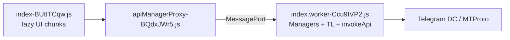

# WebK reverse — 7 ฟีเจอร์ (Reactions → E2E)

อ้างอิง bundle ใน `reverse/webk/` และ machine-readable map ที่ `src/reverse/features/webk-feature-map.json` (ส regenerating: `python3 scripts/extract-webk-features.py`)

## สถาปัตยกรรม WebK (สั้น)

- **Worker** เก็บ TL schema, `*Manager` (state + sync updates), และ `invokeApi(\`method\`)` ไป DC
- **Main thread** วาด UI, โหลด chunk ตาม `__vite__mapDeps`; proxy สะท้อน cache (`availableReactions`, `communityFull`, …) จาก worker
- Repo นี้เรียก API ตรงได้ผ่าน `MtprotoCoreSession.call` — ยังไม่มี layer เทียบ `app*Manager`

## สรุปต่อฟีเจอร์

| ฟีเจอร์ | Manager (worker) | invokeApi โดยตรง (ตัวอย่าง) | UI chunks (ชื่อไฟล์) |
|--------|------------------|-----------------------------|----------------------|
| Reactions | `appReactionsManager` | `messages.sendReaction`, `setDefaultReaction`, paid/tags | (inline ใน main — ไม่มี chunk ชื่อ reaction) |
| Scheduled | `appMessagesManager`, `appDraftsManager` | `sendScheduledMessages`, `deleteScheduledMessages` | `schedulers-CsiwybLM.js` |
| Chatlist | `appChatInvitesManager`, `appChatsManager` | `chatlists.editExportedInvite` (+ TL ครบ 16 method) | (ไม่มีชื่อ chatlist ใน deps ที่ดึงมา) |
| Stories | `appStoriesManager` | `stories.sendStory`, albums, `editStory`, … | (lazy ใน main) |
| Stickers | `appStickersManager` | (ว่างใน grep — เรียกผ่าน invoke ทั่วไป) | `sticker-*.js`, `getStickerEffectThumb-*.js` |
| Communities | `appCommunitiesManager` | `communities.create`, toggle link/ban, … | `communityAddMode-*.js` |
| E2E secret chat | `appMessagesManager` | TL: `requestEncryption`, `sendEncrypted*` | `encryptedStorageLayer-*.js`, `passcodeLockScreen-*.js` |

### Reactions

- **RPC หลัก:** `messages.sendReaction`, `getMessagesReactions`, `getRecentReactions`, `readReactions`, `setChatAvailableReactions`, paid reaction (`sendPaidReaction`, privacy/tags)
- **Stories overlap:** `stories.sendReaction`, `getStoryReactionsList`
- **Flow:** manager อัปเดตจาก `updates` + cache รายการ reaction ที่ `messages.availableReactions`; UI เลือก emoji แล้วส่ง `sendReaction` พร้อม `msg_id` / `peer`

### Scheduled messages

- **สร้าง:** `messages.sendMessage` + **`schedule_date`** (unix) — ไม่ใช่ method แยก
- **จัดการคิว:** `getScheduledHistory`, `getScheduledMessages`, `sendScheduledMessages` (ส่งทันที), `deleteScheduledMessages`
- **UI:** scheduler แยก chunk; logic อยู่ `appMessagesManager` ร่วมกับ draft

### Chatlist (shared folders)

- **RPC:** `chatlists.exportChatlistInvite`, `joinChatlistInvite`, `getChatlistUpdates`, `leaveChatlist`, …
- **Worker มี TL ครบ** แต่ `invokeApi` template เห็นน้อย (มักเรียกผ่าน helper เดียวกับ RPC อื่น)
- เกี่ยวข้องกับ **dialog filters / folders** ใน `appChatsManager`

### Stories

- **RPC:** `sendStory`, `getPeerStories`, `readStories`, albums, stealth/live, views/reactions
- **Manager:** `appStoriesManager` — sync peer stories, pinned, archive

### Stickers

- **RPC:** `messages.getAttachedStickers`, `getFeaturedStickers`, `installStickerSet`, … + `stickers.createStickerSet`, …
- TL ฝังใน worker; **ไม่ปรากฏ** ใน `invokeApi(\`stickers.\`)` เพราะ minify ใช้ตัวแปร method

### Communities

- **RPC:** `communities.create`, `getJoinedCommunities`, toggle peer link / ban, link requests
- **Proxy cache:** `communityFull`, `communityDialogs` (ใน `apiManagerProxy`)

### End-to-end encrypted chat

- **Secret chat (MTProto):** `messages.requestEncryption` → `acceptEncryption` → `sendEncrypted` / `sendEncryptedFile` / `readEncryptedHistory` / `discardEncryption`
- **ไม่สับสนกับ:** `encryptedStorageLayer` = **passcode / local encrypted storage** (IndexedDB layer) ไม่ใช่ secret-chat protocol อย่างเดียว
- WebK รองรับ secret chat จำกัดเมื่อเทียบ mobile; crypto อาจใช้ `crypto.worker-*.js` (ยังไม่ mirror ใน `reverse/webk/`)

## REA

- `analyze_javascript_application` บน `index.worker-Ccu9tVP2.js` — evidence `ev_6669d6afc0d0bcd6303cd7ccf9cd55e504d18a55a3721ff9f0b51cebad27342d` (graph partial ไฟล์ใหญ่)
- ใช้ร่วมกับ script grep ด้านบน

## ขั้นถัดไป (product)

1. Thin wrappers: `src/services/messages/reactions.ts` เรียก `session.call('messages.sendReaction', …)` ฯลฯ
2. ดาวน์โหลด chunk เพิ่มจาก CDN WebK ถ้าต้องไล่ UI flow ละเอียด (reactions/stories มักอยู่ main bundle)
3. อัปเดต `feature-gap.md` เมื่อมี service จริง
